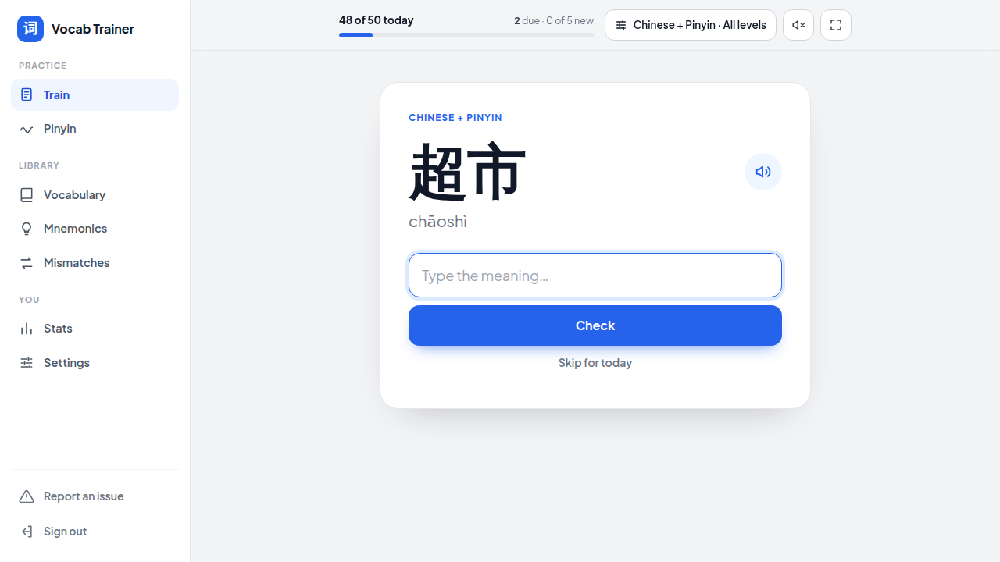
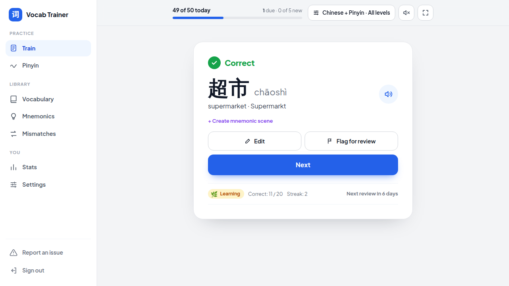
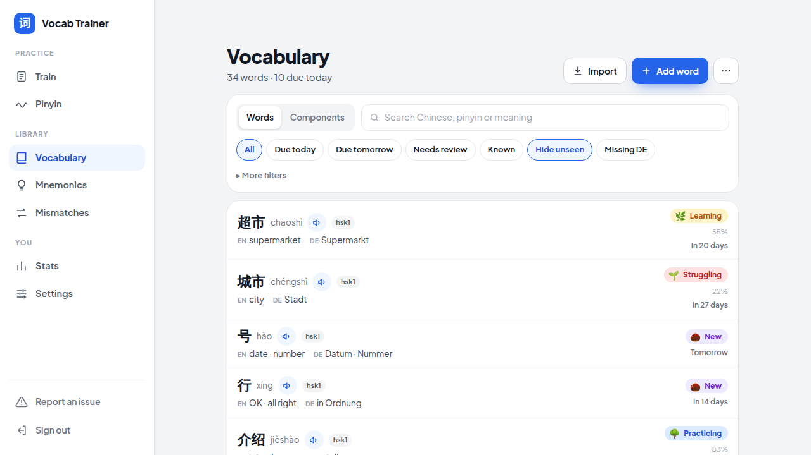
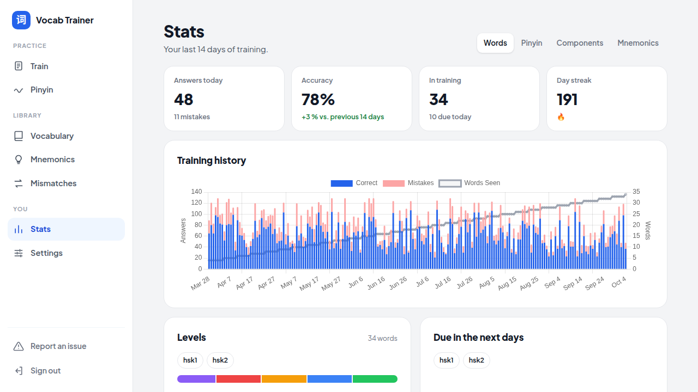
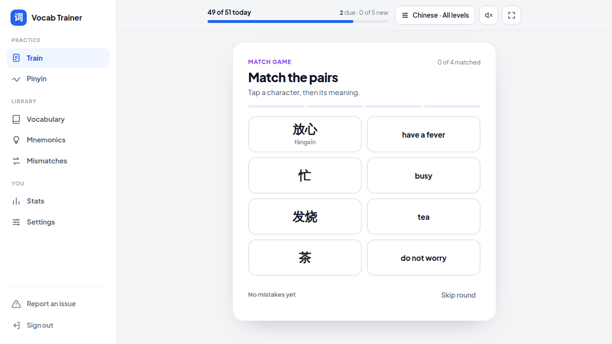
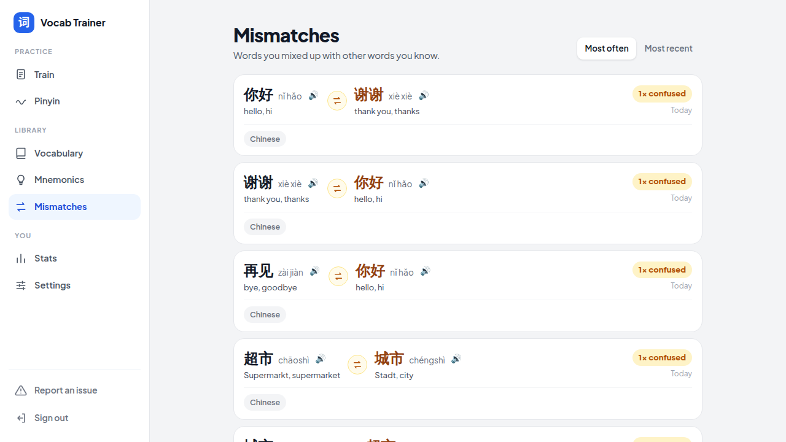
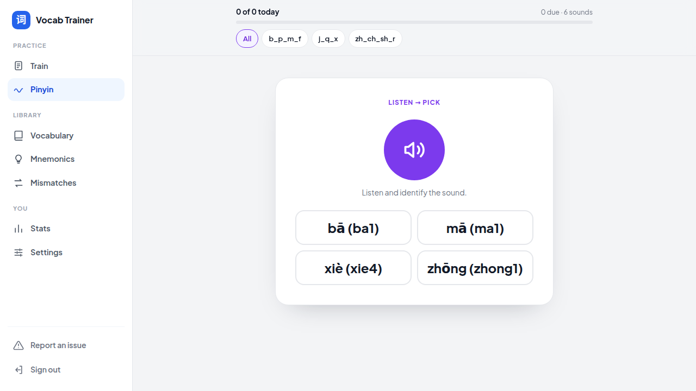
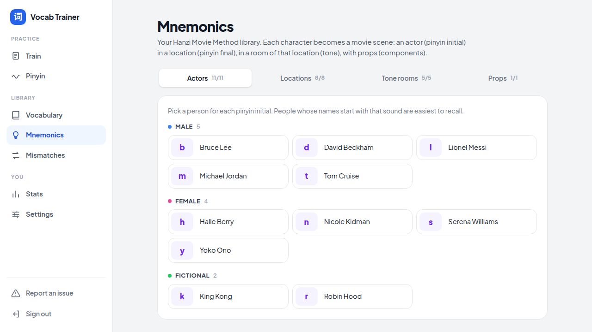
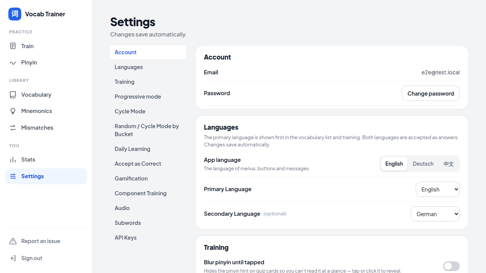

# 词汇训练 · Vocabulary Trainer

A self-hosted trainer for Chinese vocabulary, with English and German meanings. It schedules reviews with the SM-2 spaced repetition algorithm, reads every word aloud, and helps you learn characters through their components and mnemonics.

One Go binary, one SQLite file, no external services required. It runs on a Raspberry Pi.



## Quick start

Requirements: Docker and Docker Compose.

```bash
git clone https://github.com/seeb83ai/vocabulary_trainer.git
cd vocabulary_trainer
cp .env.example .env    # set SESSION_SECRET, see docs/configuration.md
make run
```

Open <http://localhost:8080>, create an account, and the setup wizard imports an HSK word list for your level.

To run without Docker, use `make dev` (Go 1.25+). For production, see [Self-hosting](docs/self-hosting.md).

## Features

- **Spaced repetition.** SM-2 scheduling, a daily new-word cap, and gates that pause new words when reviews pile up.
- **Eight quiz modes.** Chinese → meaning, meaning → Chinese, with or without pinyin, voice-only, and modes that change with your progress.
- **Ready-made word lists.** HSK 2.0 and HSK 3.0 (levels 1–9) and topic lists, with translations from CC-CEDICT and HanDeDict.
- **Forgiving answer checking.** Optional parts in brackets, alternatives, typo acceptance, and one-click "add my answer as a translation".
- **Mix-up detection.** The app notices when you typed the meaning of another word and tracks these pairs.
- **Audio.** Neural text-to-speech for every word, and a pinyin listening trainer for tones and sounds.
- **Characters.** Radical and component breakdown, component training, and Hanzi Movie Method mnemonics.
- **Example sentences.** Fill-in-the-blank training with sentences, and AI-generated sentences from words you know.
- **Stats.** Daily history, accuracy tiers, due-date forecast, and your hardest words.
- **Vocabulary management.** Search, filter by tag groups, CSV upload and download, auto-translate.
- **Multi-user and multilingual.** Accounts with email verification, UI in English, German and Chinese, phone and desktop layouts.

See [all features](docs/features.md) for the details.

## Screenshots

| | |
|---|---|
|  |  |
|  |  |
|  |  |
|  |  |

## Documentation

| | |
|---|---|
| [Features](docs/features.md) | Everything the app does, by area |
| [Scheduling and quiz modes](docs/scheduling.md) | New-word cap, gates, tiers, Progressive and Cycle modes |
| [Configuration](docs/configuration.md) | Environment variables, accounts, security, DeepL, LLM, issue reporting |
| [Self-hosting](docs/self-hosting.md) | Docker, Raspberry Pi, backups, upgrades, admin dashboard |
| [Data import](docs/data-import.md) | HSK lists, dictionaries, frequency data, pinyin audio |
| [HTTP API](docs/api.md) | All API endpoints |
| [Development](docs/development.md) | Setup, project layout, tests, screenshots |
| [Architecture decisions](docs/adr/) | Why things are the way they are |

## Contributing

Bug reports and ideas are welcome as GitHub issues. For code changes, read [Development](docs/development.md) and [CLAUDE.md](CLAUDE.md). Every change comes with tests, and `make test-all` must pass.

## Credits

Word lists, dictionaries and audio come from [complete-hsk-vocabulary](https://github.com/drkameleon/complete-hsk-vocabulary) (MIT), [CC-CEDICT](https://www.mdbg.net/chinese/dictionary?page=cedict) (CC BY-SA 4.0), [HanDeDict](https://handedict.zydeo.net/en/) (CC BY-SA 2.0 DE), [makemeahanzi](https://github.com/skishore/makemeahanzi), [FrequencyWords](https://github.com/hermitdave/FrequencyWords) (CC BY-SA 4.0) and [mp3-chinese-pinyin-sound](https://github.com/davinfifield/mp3-chinese-pinyin-sound). The app lists all sources and licenses at `/credits`. For the files in this repository, see [THIRD_PARTY_NOTICES.md](THIRD_PARTY_NOTICES.md).

## License

[MIT](LICENSE)
